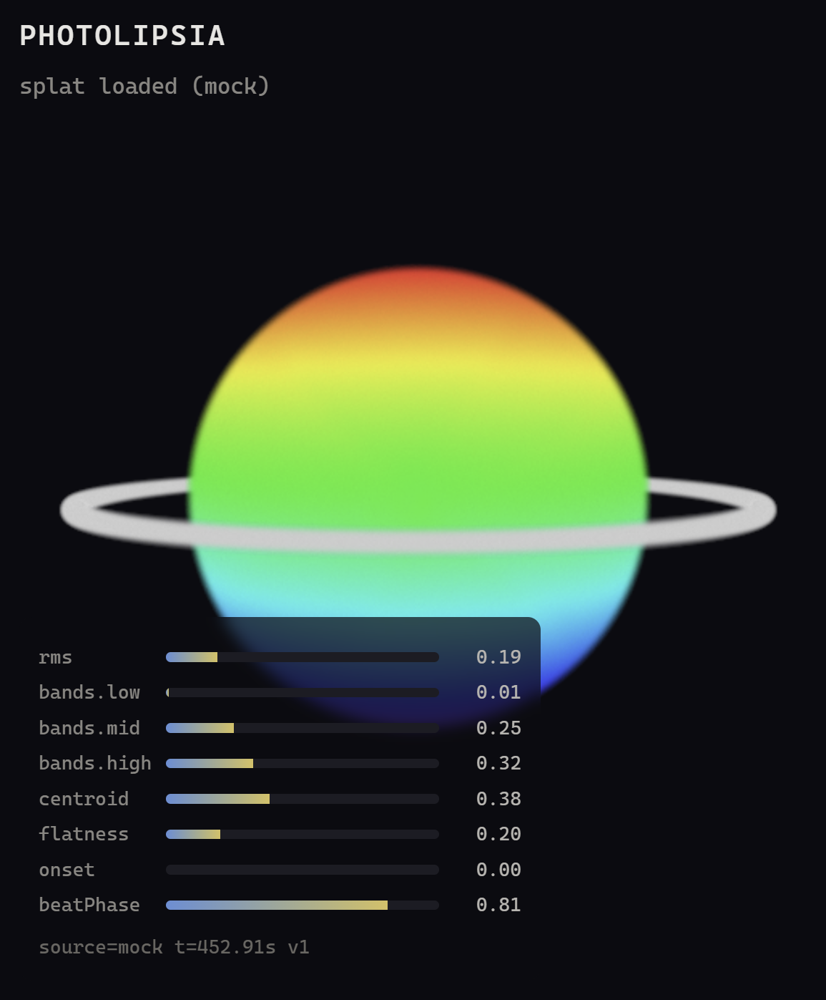
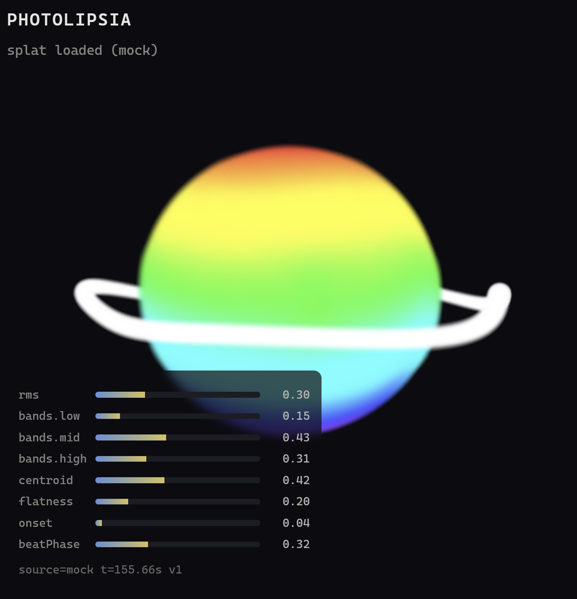

# Photolipsia — 高斯泼溅音画可视化器

一个**通用的** Gaussian Splatting 音画互动 visualizer：不绑定任何 DSP 来源，
任何能发声或能分析声音的系统都可以驱动它跳动。

```
                    ┌─ Driver: web-audio（麦克风 / 音频文件 / 屏幕声音，浏览器内分析）
任意 DSP 源 ──→  AVParams 协议（唯一契约）──→ mapping（纯函数）──→ splat 渲染
                    ├─ Driver: osc（WebSocket ← UDP 桥 ← Max/MSP·SuperCollider·PD）
                    ├─ Driver: midi（Web MIDI API：note/CC/clock）
                    └─ Driver: mock（合成信号 + 参数流回放）
```

核心原则：**visualizer 只认协议，不认来源**。接一个新 DSP = 写一个新驱动器，
visualizer 本体永远不动。

## 效果

**Stage 1 — 渲染基础**（`ai/stage1.png`）：测试 splat 全屏渲染，
mock 驱动下整体呼吸。



**Stage 2 — per-splat GPU 音频变形**（`ai/stage2.png`）：同一测试 splat，
音频驱动进 GPU dyno graph 后——圆环随波动扭曲、表面起伏、亮度随频段能量脉动。
对比 Stage 1 的静止圆环即可看出 per-splat 位移在工作。



## 快速开始

```sh
npm test        # 单元测试（node:test，零依赖）
npm run check   # 冒烟检查
npm run dev     # 本地静态服务器 → http://localhost:5175
```

页面用 URL 参数选驱动器：`http://localhost:5175/?driver=mock`
（目前只有 `mock` 可用，其余见 Roadmap）。

## 目录结构

```
AGENTS.md            agent 规则（plan → build → introspect → fix → log）
ai/strategy.md       计划 / 决策 / Next（agent 的记忆，每次任务先读它）
ai/log.md            开发日志，一次工作一段（新的在上）
docs/protocol.md     AVParams 协议规范 ★ 系统的 API 契约
docs/architecture.md 架构与 Roadmap
docs/course-notes.md 与 photolipsia-agentic-kit 课程的关系
src/protocol/        协议定义与校验
src/drivers/         各来源驱动器（统一接口）
src/dsp/             可单测的 DSP 纯函数（频段能量 / 质心 / 平滑…）
src/mapping/         协议 → 视觉参数（纯函数）
src/ui/              debug monitor
scripts/             dev 服务器 / check 脚本
test/                单元测试
```

## 工作方式

本项目借鉴 [photolipsia-agentic-kit](https://github.com/xohm/photolipsia-agentic-kit)
（ZHdK Agentic Coding 课程）的工作流：人负责规划、决策、检查；agent 负责写代码。
每次改动必须过 `npm test`，每段工作在 `ai/log/` 留档，决策记录在 `ai/strategy.md`。

## 状态

Stage 0（骨架）已完成，Roadmap 见 `ai/strategy.md`。
