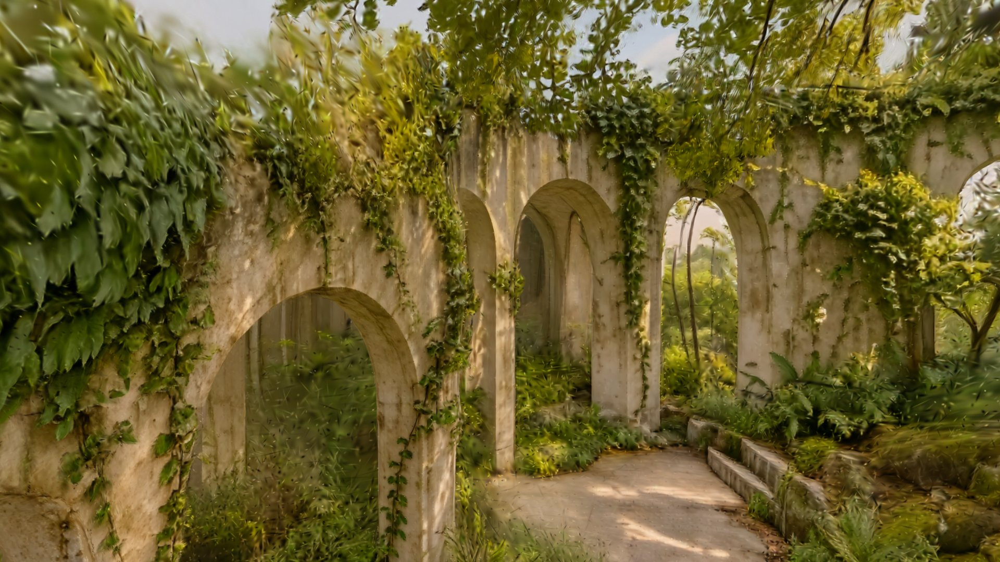
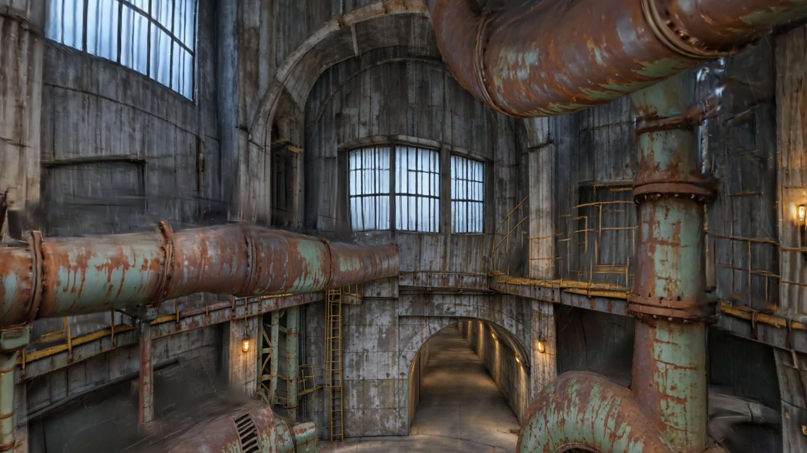
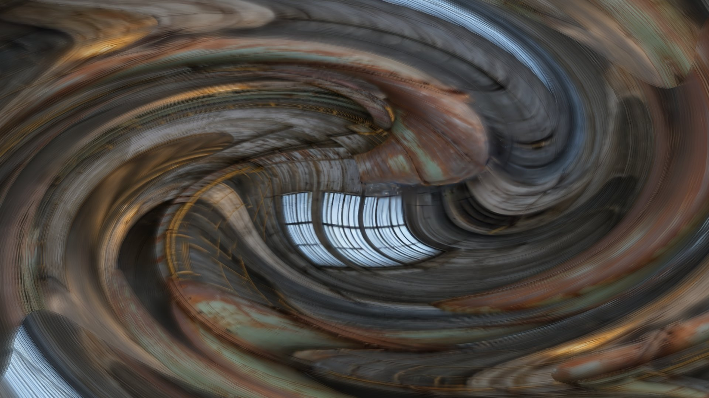
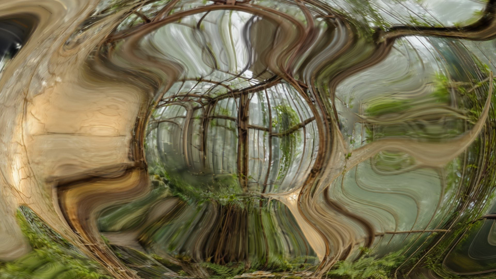
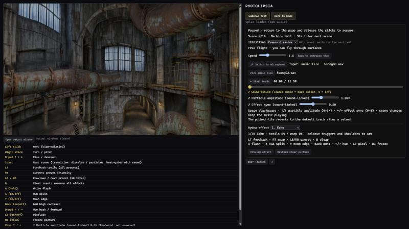
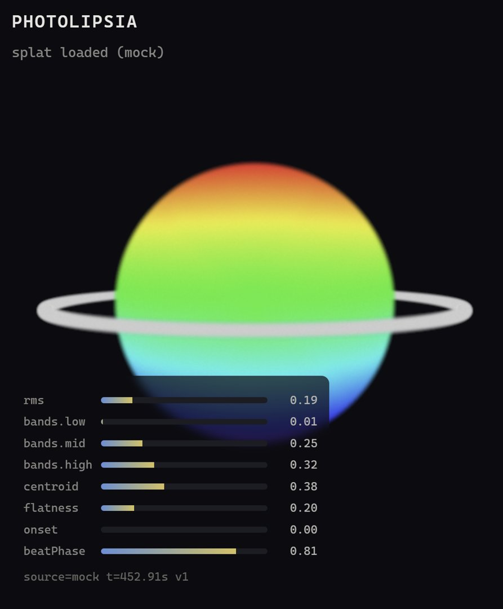
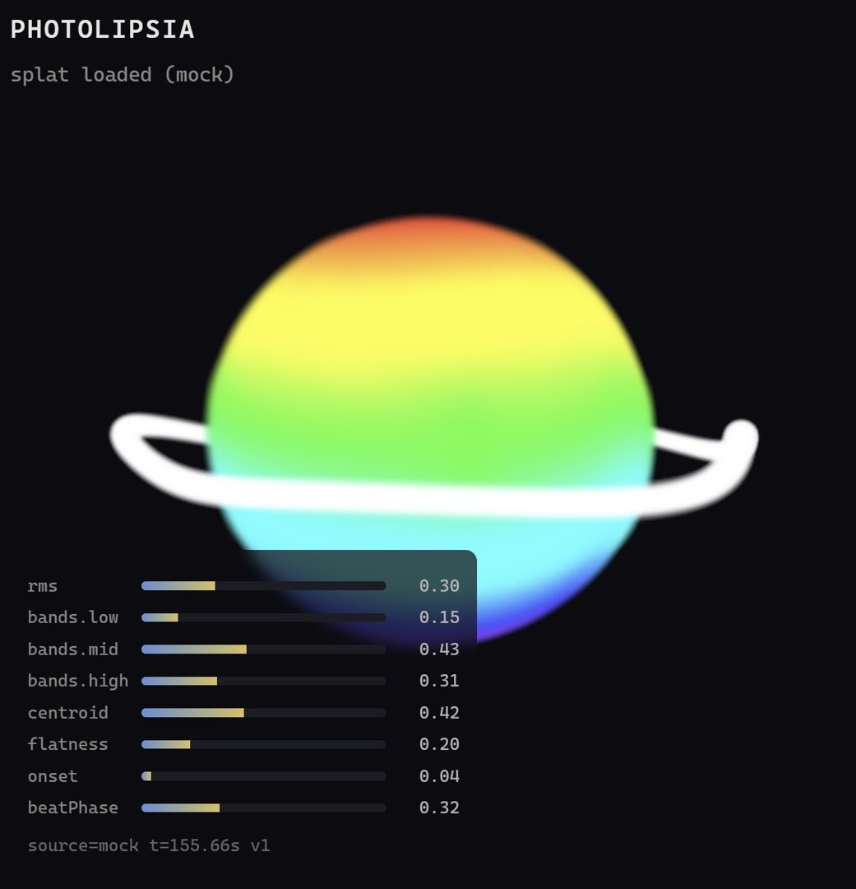

# Photolipsia — Gaussian-Splat VJ Performance



**Photolipsia** is a real-time audiovisual VJ instrument built on Gaussian splatting. Ten Gaussian-splat worlds, generated with Marble (World Labs), form one journey from a cold ruin to an overgrown garden (**inorganic → life → fusion → rebirth**). The performer flies through them live with a game controller while the music moves the splats and Hydra effects reshape the image. It was used for a **10-minute live performance**.

The project comes from my artistic practice, which combines natural and mechanical elements, with VJing as one of my main media.

- **Performance video (10 min):** <https://youtu.be/71Y-s4JzuZc>
- **Course documentation (idea, process, result):** [course-summary/README.md](course-summary/README.md)
- **Archived Unity attempt:** <https://github.com/orangespy-arts/guassian-splating-unity>

<table>
<tr>
<td><br><sub>Machine Hall, clean</sub></td>
<td><br><sub>Machine Hall with the Vortex preset</sub></td>
</tr>
<tr>
<td><br><sub>Mycelium Greenhouse with the Tunnel preset</sub></td>
<td><br><sub>Dual-screen performance console</sub></td>
</tr>
</table>

## Features

- **Ten splat scenes:** Ruin Entrance, Empty City, Underground Pass, Machine Hall, Underwater Atrium, Mycelium Greenhouse, Crystal Rift, Mutated Temple, Cloud Ruins, Rebirth Garden.
- **Controller free flight:** left stick moves, right stick looks, D-pad rises and descends. An automatic start point is found for each scene.
- **Hydra effects** (hydra-synth 1.4.0) on the same canvas as the splats: 10 presets (Echo, Ripple, Vortex, Tunnel, Scan glitch, Strobe, Posterize, Print, Split, Melt) plus button layers (flash, RGB split, neon edge, mono, hue, pixelate, freeze).
- **Music link:** the show track drives splat motion and effect strength. You can switch to a live microphone, pick any local audio file and scrub the track.
- **Beat-synced scene changes:** Start goes to the next scene. The change waits for the next strong beat (up to 1 s) and uses a freeze-dissolve or a particle scatter.
- **Dual-screen mode:** a laptop console with a live key map, plus a clean output window for the projector.
- **Generic audio protocol:** visuals only read `AVParams` (loudness, bands, centroid, onset, beat phase), so any source can drive them: Web Audio, OSC (Max/MSP, SuperCollider, PD), MIDI, or a recorded parameter stream.

## Quick start

Requires Node.js.

```sh
npm ci          # install dependencies (first time)
npm test        # unit tests
npm run check   # tests + module import smoke check
npm run dev     # local server → http://localhost:5175
```

Open <http://localhost:5175/> and choose an entry:

| Entry | Use |
|---|---|
| Dual-screen show · Console | Laptop console + external output window |
| Single-screen show · Music | One window, default show track built in |
| Gamepad VJ · Free flight | Picture and controller only, no music |
| Gamepad test | Check stick, trigger and button readings |
| Explore · Particle Portal | Earlier explorer mode (glass ball, growing plants, portal) |

Useful URLs: `/?vj=1&scene=s01&audio=show&console=1` (console), `&perform=1` (hide the UI), `&res=1280x720` (lower render load), `&hydra=0` (no effects).

### Local assets (not in git)

- Scenes: `3dscene/ruin1.ply` to `ruin10.ply` (about 130 MB each)
- Default show track: `audio/5songDJ.wav`. Without it, use "Pick music file" in the music panel.

## Controller mapping

| Input | Action |
|---|---|
| Left stick / right stick | Move / look |
| D-pad ↑ ↓ | Rise / descend |
| D-pad ← → | Hue back / forward |
| LT | Feedback trails |
| RT | Strength of current preset |
| LB / RB | Previous / next preset |
| Start | Next scene |
| A (hold) | White flash |
| X / Y / Back | RGB split / neon edge / black-and-white |
| L3 / R3 | Pixelate / freeze |
| B | Clear all effects |

Keyboard: Space play/pause, ↑/↓ particle amplitude, ←/→ effect sync, H hide console, F fullscreen. Full details: [docs/vj-controls.md](docs/vj-controls.md).

## Architecture

```
any DSP source ──→ driver ──→ AVParams protocol ──→ mapping (pure functions) ──→ splat render ──→ Hydra
   web-audio · osc · midi · mock · playback
```

The visuals only depend on the protocol, never on where the sound comes from. Adding a new source means writing a new driver.

| Path | Contents |
|---|---|
| `src/protocol/` | Protocol definition and validation |
| `src/drivers/` | Audio sources (web-audio, OSC, MIDI, mock, playback) |
| `src/mapping/` | Pure functions: audio → visuals, effects, transitions |
| `src/render/` | Spark splat stage, flight, explorer, Hydra stage |
| `src/input/` | Gamepad input |
| `src/ui/` | Console, panels, monitor |
| `src/rec/` | Parameter recording and playback |
| `scripts/` | Dev server, checks, probes |
| `test/` | Unit tests (`node:test`) |
| `course-summary/` | Course documentation and media |

Docs: [protocol](docs/protocol.md) · [architecture](docs/architecture.md) · [VJ controls](docs/vj-controls.md) · [rehearsal](docs/rehearsal.md) · [navigation](docs/navigation.md) · [start guide (Chinese)](START.md)

Scenes: generated with Marble (World Labs), exported as PLY. Stack: three.js 0.186 · Spark 2.4 · hydra-synth 1.4.0 · Web Audio / Web MIDI / Gamepad APIs.

## How it was made

Built for the ZHdK MA Interaction Design course *Agentic Coding*, following the workflow of [photolipsia-agentic-kit](https://github.com/xohm/photolipsia-agentic-kit). I did the planning, decisions and testing; a coding agent wrote the code. Each step was planned in `ai/strategy.md` before it was built, every change had to pass `npm test`, and every session is logged in `ai/log.md` (both in Chinese). Agent rules are in [AGENTS.md](AGENTS.md).

### Early stages

<table>
<tr>
<td><br><sub>Stage 1 — first splat breathing</sub></td>
<td><br><sub>Stage 2 — per-splat GPU audio deformation</sub></td>
</tr>
</table>
