# Photolipsia — A Gaussian-Splat VJ Journey from Ruin to Rebirth

*Course documentation · ZHdK MA Interaction Design · Agentic Coding · Zhanlan · Oct–Nov 2026*

**Photolipsia** is a real-time audiovisual performance. Ten Gaussian-splat scenes form one journey from a cold, inorganic ruin to an overgrown garden. I fly through them live with a game controller while the music drives the splats, and I layer Hydra-style video effects on top. The project ended in a **10-minute live performance**.

> ▶ **Performance video:** *[insert link or embedded video here]*

---

## 1. The Idea

### Starting point

*Photolipsia* was the course theme. I approached it through my own artistic practice: I make work by **combining natural and mechanical elements**, and **VJing is one of my main media**. So I asked:

> What happens when a captured 3D space turns into a VJ instrument, and the machine slowly turns into nature as the music plays?

### Why Gaussian splats, music and VJ

- **Gaussian splatting** turns a scene into millions of small soft points instead of hard surfaces. The points can breathe, shake and dissolve with sound, which hard geometry can't do as easily.
- **Music** is the score. One continuous track runs through the whole piece, so the ten scenes feel like a single set rather than ten separate demos.
- **VJing** keeps it live. I wanted a performance I could play in the moment, not a pre-rendered video.

### The narrative arc

The ten scenes follow one arc: **inorganic → life → fusion → rebirth**. Plants grow more prominent in scenes 2, 6 and 10, and the last scene echoes the first.

| # | Scene | Role in the arc |
|---|---|---|
| 1 | Ruin Entrance | cold, inorganic opening |
| 2 | Empty City | first plants in the cracks |
| 3 | Underground Pass | the beat appears |
| 4 | Machine Hall | the machine at its fullest |
| 5 | Underwater Atrium | water enters the architecture |
| 6 | Mycelium Greenhouse | nature takes over the structure |
| 7 | Crystal Rift | mineral, alien |
| 8 | Mutated Temple | climax: crystal, iron and vines fused |
| 9 | Cloud Ruins | release, open space |
| 10 | Rebirth Garden | overgrown; echoes the opening |

<table>
<tr>
<td>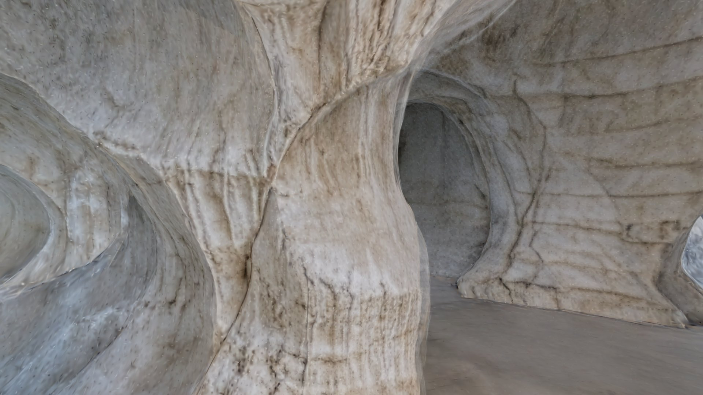 1 · Ruin Entrance</td>
<td> 2 · Empty City</td>
</tr>
<tr>
<td>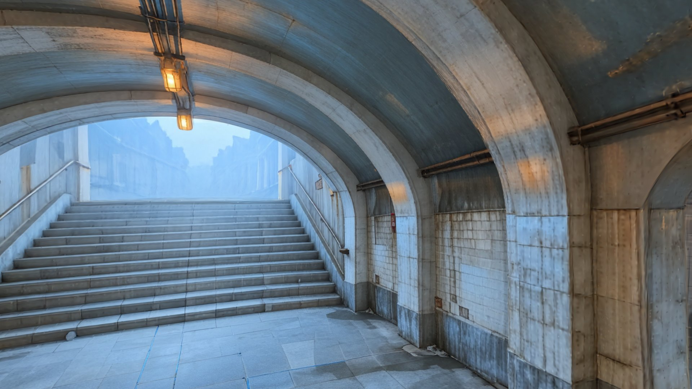 3 · Underground Pass</td>
<td>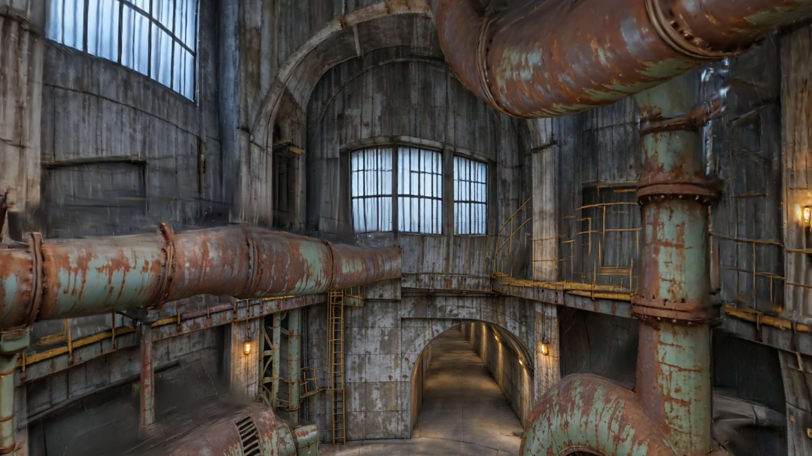 4 · Machine Hall</td>
</tr>
<tr>
<td>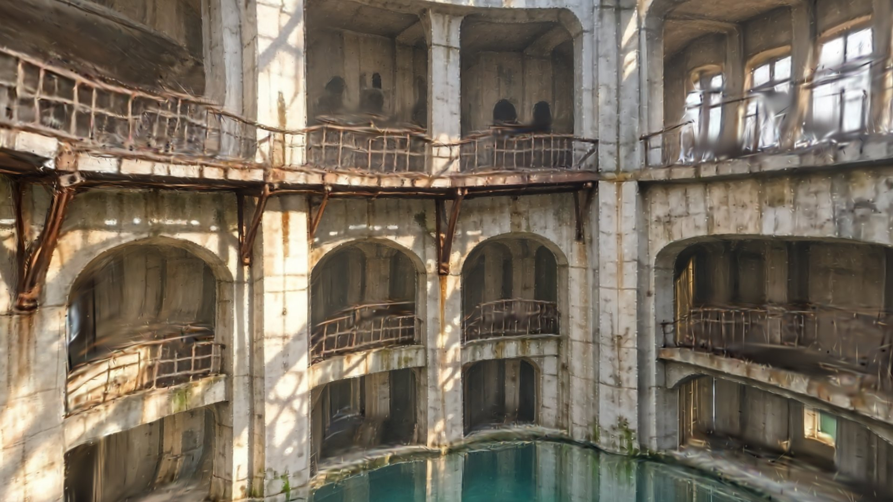 5 · Underwater Atrium</td>
<td> 6 · Mycelium Greenhouse</td>
</tr>
<tr>
<td>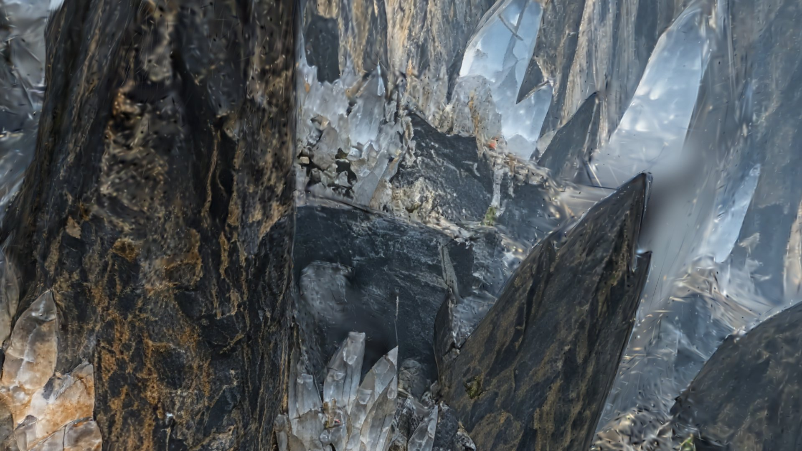 7 · Crystal Rift</td>
<td> 8 · Mutated Temple</td>
</tr>
<tr>
<td> 9 · Cloud Ruins</td>
<td> 10 · Rebirth Garden</td>
</tr>
</table>

---

## 2. The Process

I worked with an AI coding agent, following the course's agentic workflow. I did the planning, the decisions, the checking and all hands-on testing. The agent wrote the code. Every step was first written as a plan in [`ai/strategy.md`](../ai/strategy.md) and only built after I said "go"; every session was logged in [`ai/log.md`](../ai/log.md) (both in Chinese). Those two files, plus the logs in the Unity repository, are the full record of the experiments below.

### Phase 1 — A generic audio-visual splat engine (web, 26 Oct)

I started in the browser with **three.js + Spark**, a Gaussian-splat renderer, and built the system in small stages:

- **Stage 1:** render a test splat and make it breathe.
- **Stage 2:** move the deformation onto the GPU, so each splat reacts to the audio on its own (ripples, surface waves, brightness pulses) instead of the whole object scaling.
- **Stages 3–5:** three ways to drive it: live audio (mic or file) analysed in the browser, OSC (so Max/MSP, SuperCollider or PD can drive it), and MIDI.
- **Stages 6–7:** record and replay parameter streams, and harden the system for performance.

The key design decision was **one protocol** (`AVParams`: loudness, low/mid/high bands, centroid, onset, beat phase). The visuals only read this protocol and never care where the sound comes from.

<table>
<tr>
<td> Stage 1 — test splat breathing on a synthetic signal</td>
<td>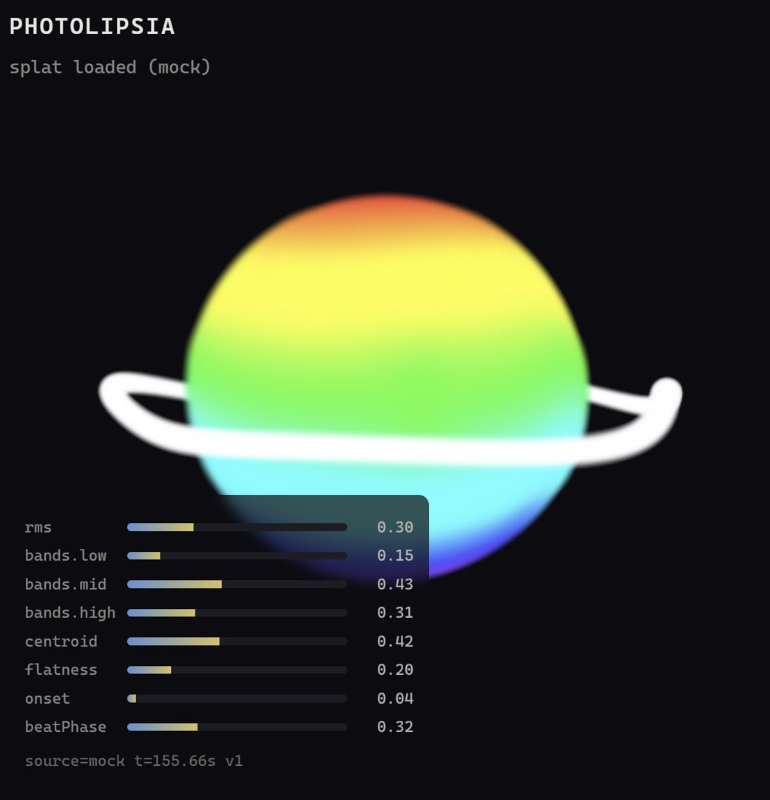 Stage 2 — per-splat GPU deformation</td>
</tr>
<tr>
<td> Stage 3 — driven by real audio</td>
<td>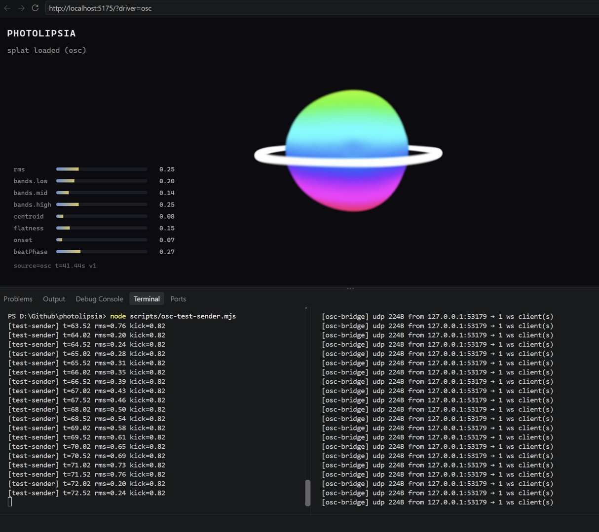 Stage 4 — driven over OSC from an external program</td>
</tr>
</table>

### Phase 2 — Exploring real scans: a glass ball that grows plants (27–30 Oct)

Next I loaded my first real scan, a ruin hall, and tried a game-like mode. A **transparent glass ball** rolls through the ruin, and **leaves and stems grow wherever it passes**. This was my first literal version of "machine turning into nature". I then added a **particle portal** that carries the ball from the ruin into a second scan, a zombie city.

<table>
<tr>
<td>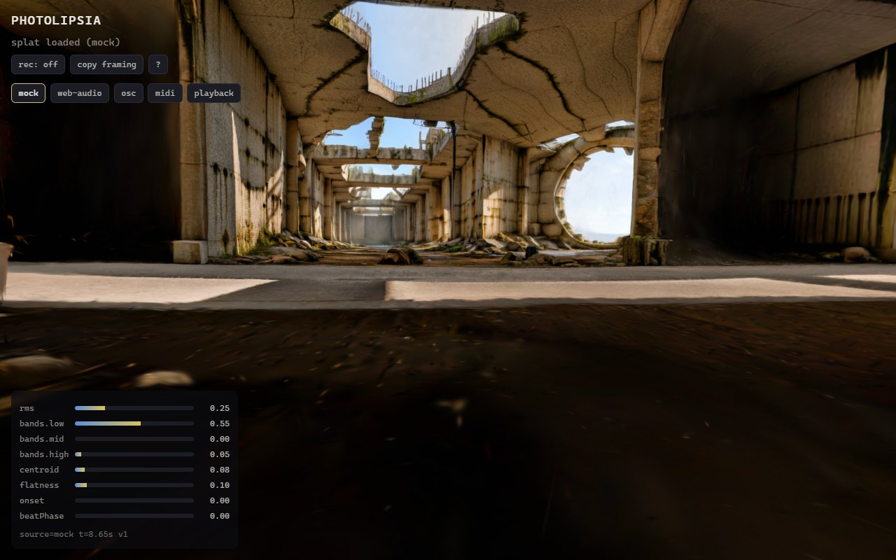 First real scan: the ruin hall, shaking with sound</td>
<td> The glass ball in the zombie city, after the portal</td>
</tr>
</table>

**What I learned:** walking with a ball felt like a game, not a performance. Steering the ball took all my attention, and there was nothing left for the music.

### Phase 3 — Detour: moving to Unity (early Nov)

To get a clean, editable ten-scene piece, I tried moving the project to **Unity (URP) with the UnityGaussianSplatting package**:

- I got the first scan rendering (1,920,000 splats) and a whole-object "breathing" prototype reacting to the music.
- I built a Timeline camera move, then switched to free walking so I could record directly.
- I built a ten-scene structure with one continuous music track and scene switching, plus game-controller flight.
- I tried a beat-triggered **dust particle** effect. I didn't like it, so I dropped it. I wanted the effect to happen *in the splats themselves*, not on top of them.
- Because Hydra couldn't run inside Unity, I started rebuilding a Hydra-style effect system in Unity shaders (about 34 functions plus a small compiler).

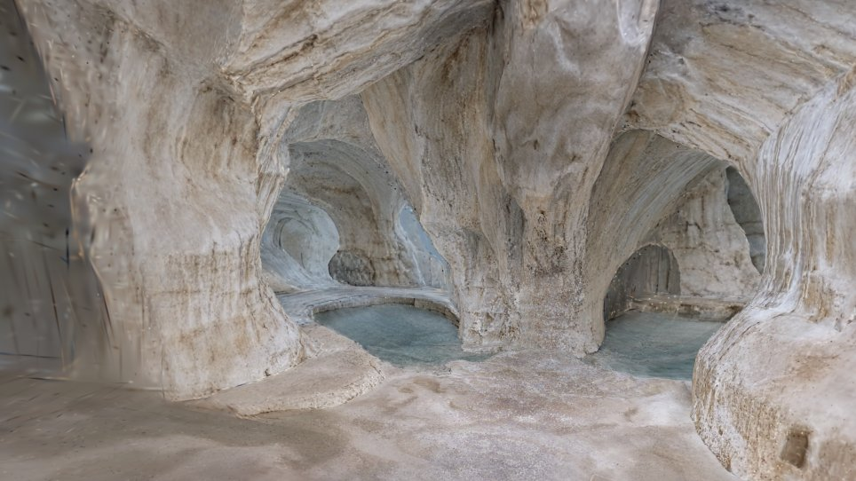
Unity version — the entrance scene rendered with UnityGaussianSplatting

**Why I abandoned Unity:** Hydra is built on WebGL/GLSL, and **Unity's rendering could not connect to Hydra**. I could only imitate it by rewriting every effect by hand, and I would lose the thing I wanted most: Hydra itself, live, as part of my VJ practice. The Unity package also didn't let me move individual splats, so the per-splat audio deformation I already had on the web was gone. I went back to the browser, where splats and Hydra share the same canvas.

### Phase 4 — Back to the web: a controller-driven VJ instrument (4–5 Nov)

Back on the web I rebuilt the piece as a **live VJ instrument**:

1. **Controller test page** to check that the browser reads every stick, trigger and button.
2. **Free flight** with an Xbox controller: the left stick moves, the right stick looks around, the D-pad rises and falls.
3. **Hydra (hydra-synth 1.4.0)** runs on the same canvas as the splats. LT controls feedback trails, RT controls the current preset's strength, and LB/RB switch presets.
4. **The ten scenes** replace the two test scans. Start moves to the next scene; the transition waits for the next strong beat (up to 1 second) and uses either a freeze-dissolve or a particle scatter.
5. **Music link**: the show track drives splat motion and effect strength; I can switch to a live microphone, pick another track or scrub through it.
6. **Ten effect presets**, plus single-button layers: flash, RGB split, neon edge, black-and-white, hue shift, pixelate, freeze.
7. **Dual-screen setup**: a control console on the laptop and a clean output window on the projector.

Early version of the web VJ panel (Chinese UI) in the Machine Hall

---

## 3. The End Result

The final piece is a **10-minute live VJ performance**. A single continuous music track plays while I fly through all ten scenes with a controller, play the Hydra effects on top, and move from ruin to garden.

> ▶ **Performance video:** *[insert link or embedded video here]*

### Hydra effects on the splat scenes

<table>
<tr>
<td> Vortex · Machine Hall</td>
<td> Ripple · Machine Hall</td>
</tr>
<tr>
<td> Scan glitch · Machine Hall</td>
<td> Posterize · Machine Hall</td>
</tr>
<tr>
<td> Tunnel · Mycelium Greenhouse</td>
<td> Echo · Mycelium Greenhouse</td>
</tr>
<tr>
<td>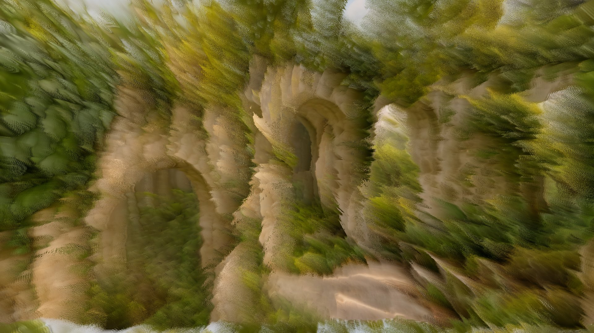 Melt · Rebirth Garden</td>
<td> Split · Rebirth Garden</td>
</tr>
</table>

### The performance console

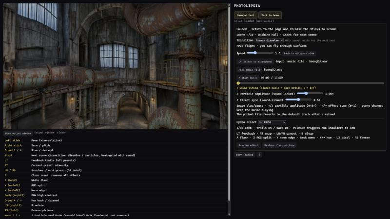
Laptop console: output preview and live key map on the left; scene, music, effect and flight panels on the right. A separate window sends the clean image to the projector.

### Controller mapping

| Input | Action |
|---|---|
| Left stick / right stick | Move / look |
| D-pad ↑ ↓ | Rise / descend |
| D-pad ← → | Hue shift |
| LT | Feedback trails |
| RT | Strength of current preset |
| LB / RB | Previous / next preset (10 total) |
| Start | Next scene (beat-synced transition) |
| A (hold) | White flash |
| X / Y / Back | RGB split / neon edge / black-and-white |
| L3 / R3 | Pixelate / freeze |
| B | Clear everything back to the clean image |

### Technical summary

- **Rendering:** three.js 0.186 + Spark 2.4 (Gaussian splats), ten PLY scans (~130 MB each)
- **Effects:** hydra-synth 1.4.0 on the same canvas
- **Audio:** Web Audio analysis → `AVParams` protocol (also supports OSC and MIDI)
- **Input:** Gamepad API, Xbox controller
- **Output:** dual-screen console with a clean output window

---

## 4. Reflection

- **Choose the medium for the practice, not the polish.** Unity promised a cleaner pipeline, but it cut me off from Hydra, which is part of how I perform. Going back to the web was the right call.
- **Effects belong in the material.** The dust particles and the whole-object scaling both felt like decoration. The splats moving and dissolving with sound, and Hydra reshaping the image, felt like the scene itself reacting.
- **A game isn't a performance.** The glass-ball mode was fun but took all my attention. Free flight plus effects on one controller let me play the music.
- **Working with an agent.** Writing a plan before each step and logging every session made the many changes of direction manageable. It also kept a record of why each decision was made.

### Next steps

- Per-scene camera paths and calibrated starting points
- Bringing the plant growth from Phase 2 into the performance scenes
- Live OSC input from music software for performances with other musicians

---

## Links

- Web version (final, this repository): [README](../README.md) · <https://github.com/orangespy-arts/photolipsia>
- Unity attempt (archived): <https://github.com/orangespy-arts/guassian-splating-unity>
- Course kit: <https://github.com/xohm/photolipsia-agentic-kit>
