# Photolipsia: Playing Generated Gaussian-Splat Worlds as a Live VJ Instrument

*Course documentation · ZHdK MA Interaction Design · Agentic Coding · Zhanlan · Oct–Nov 2026*

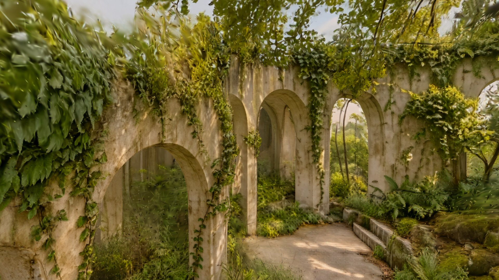

**Photolipsia** turns ten Gaussian-splat worlds, generated with **Marble** (World Labs), into an instrument for a live audiovisual performance. Music moves each splat individually on the GPU, Hydra effects reshape the same image in real time, and one game controller handles both the camera flight and the effects. The ten scenes form one arc from a cold, inorganic ruin to an overgrown garden. I played the instrument in a **10-minute live performance**.

> ▶ **Performance video:** <https://youtu.be/71Y-s4JzuZc>

---

## 1. The Idea

### Starting point

*Photolipsia* was the course theme. I approached it through my own artistic practice, in which I **combine natural and mechanical elements** and use **VJing as one of my main media**. The project starts from one question:

> What happens when a captured 3D space turns into a VJ instrument, and the machine slowly turns into nature as the music plays?

### Why Gaussian splats, music and VJ

- **Gaussian splatting** represents a scene as millions of small soft points. I generated every scene in the piece with Marble and exported it as a PLY file, which the instrument loads and renders directly. Each point can breathe, shake and dissolve with sound, which hard surface geometry cannot do as easily.
- **Music** is the score. One continuous track runs through the whole piece and holds the ten scenes together as a single set.
- **VJing** keeps the piece live. Every camera move and every effect is played in the moment.

### The narrative arc

The ten scenes follow one arc: **inorganic → life → fusion → rebirth**. Plants grow more prominent in scenes 2, 6 and 10, and the last scene echoes the first.

| # | Scene | Role in the arc |
|---|---|---|
| 1 | Ruin Entrance | cold, inorganic opening |
| 2 | Empty City | first plants in the cracks |
| 3 | Underground Pass | the beat appears |
| 4 | Machine Hall | the machine at its fullest |
| 5 | Underwater Atrium | water enters the architecture |
| 6 | Mycelium Greenhouse | nature takes over the structure |
| 7 | Crystal Rift | mineral, alien |
| 8 | Mutated Temple | climax: crystal, iron and vines fused |
| 9 | Cloud Ruins | release, open space |
| 10 | Rebirth Garden | overgrown; echoes the opening |

<table>
<tr>
<td> 1 · Ruin Entrance</td>
<td>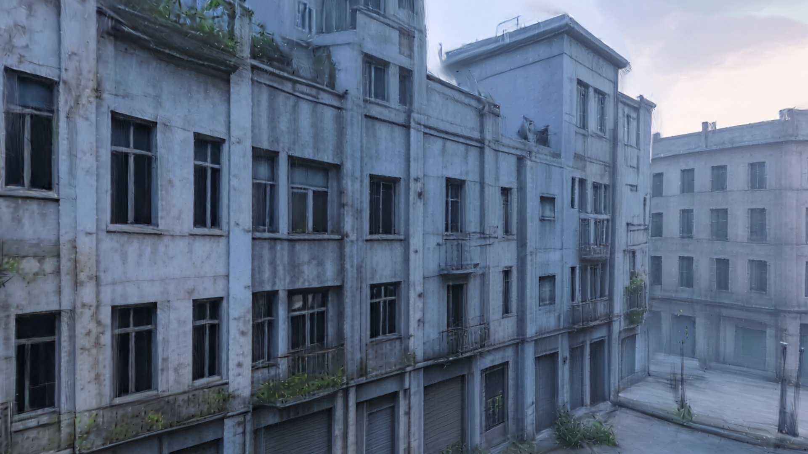 2 · Empty City</td>
</tr>
<tr>
<td> 3 · Underground Pass</td>
<td> 4 · Machine Hall</td>
</tr>
<tr>
<td> 5 · Underwater Atrium</td>
<td>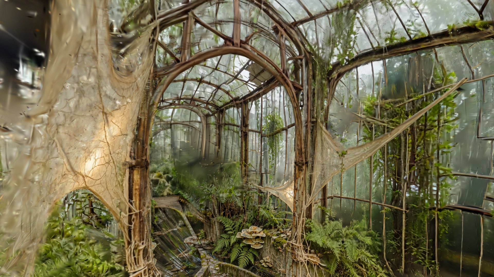 6 · Mycelium Greenhouse</td>
</tr>
<tr>
<td> 7 · Crystal Rift</td>
<td>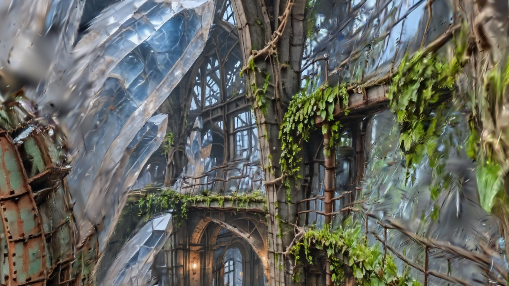 8 · Mutated Temple</td>
</tr>
<tr>
<td>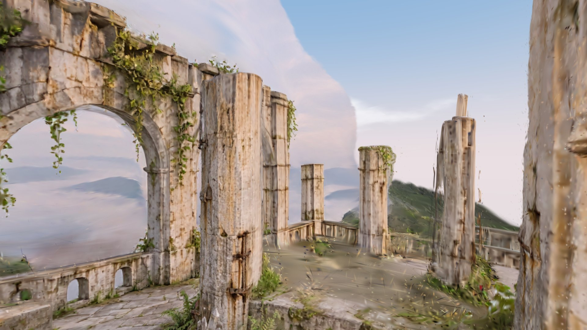 9 · Cloud Ruins</td>
<td> 10 · Rebirth Garden</td>
</tr>
</table>

---

## 2. The Process

Four prototypes answered the four design questions behind the instrument. They settled how sound acts on the splats, how the performer moves through a scene, which platform carries Hydra together with the splats, and how one person controls everything at once. Each answer became part of the final instrument.

I developed the project with an AI coding agent, following the workflow of the *Agentic Coding* course. I planned each step, made the decisions and tested every result by hand, and the agent wrote the code. Every step was written as a plan in [`ai/strategy.md`](../ai/strategy.md) and built only after I approved it with "go". Every session is logged in [`ai/log.md`](../ai/log.md). Both files are in Chinese and, together with the logs in the Unity repository, document every experiment described below.

### Prototype 1: sound acting on each splat (web, 26 Oct)

The first prototype runs in the browser with **three.js and Spark**, a Gaussian-splat renderer, and was built in seven stages:

- **Stage 1:** a test splat breathes with a synthetic signal.
- **Stage 2:** the deformation moves to the GPU, so each splat reacts to the audio individually with ripples, surface waves and brightness pulses.
- **Stages 3–5:** three input sources drive it: live audio (microphone or file) analysed in the browser, OSC from Max/MSP, SuperCollider or PD, and MIDI.
- **Stages 6–7:** parameter streams can be recorded and replayed, and the system is hardened for performance.

All visuals read a single protocol, **`AVParams`** (loudness, low/mid/high bands, centroid, onset, beat phase), and never depend on where the sound comes from. A new sound source therefore needs only a new driver, and the visuals stay unchanged.

<table>
<tr>
<td>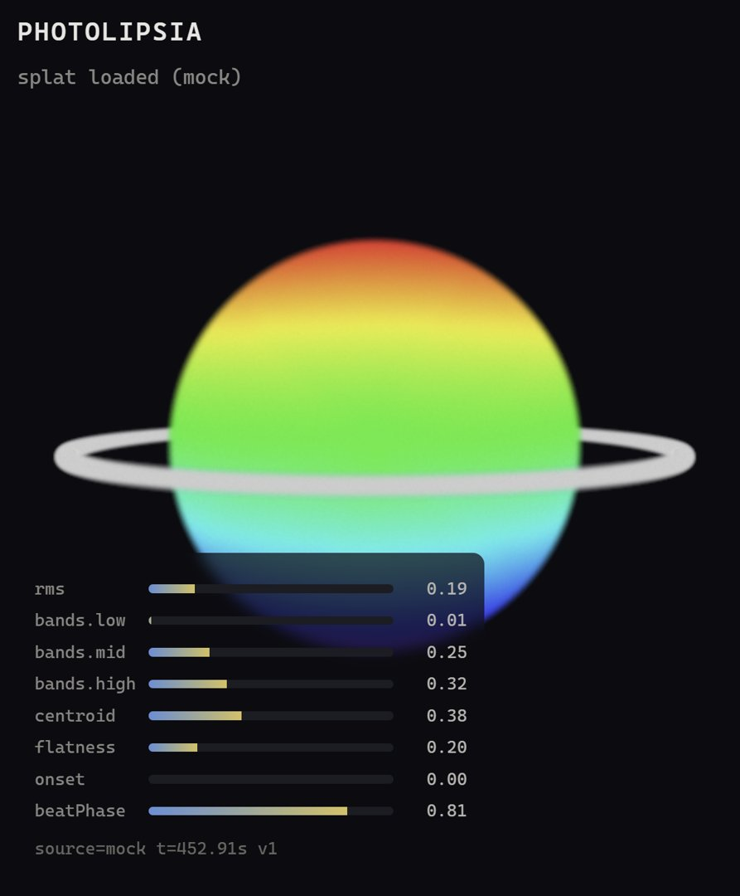 Stage 1: test splat breathing on a synthetic signal</td>
<td> Stage 2: per-splat GPU deformation</td>
</tr>
<tr>
<td>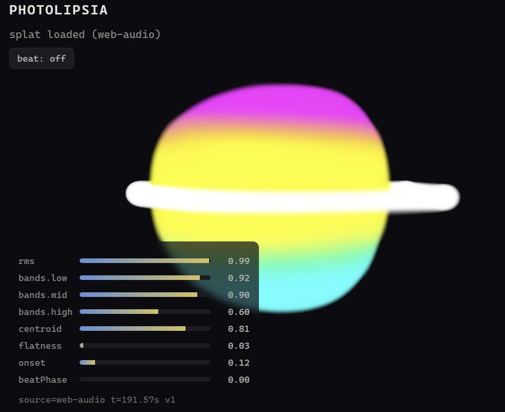 Stage 3: driven by real audio</td>
<td> Stage 4: driven over OSC from an external program</td>
</tr>
</table>

### Prototype 2: moving through a generated world (27–30 Oct)

The second prototype loads the first full Marble world, a ruin hall. A **transparent glass ball** rolls through it. **Leaves and stems grow wherever the ball passes**, which gave the theme of machine turning into nature its first literal form. A **particle portal** then carries the ball from the ruin into a second Marble world, a zombie city.

<table>
<tr>
<td> First Marble world: the ruin hall, shaking with sound</td>
<td>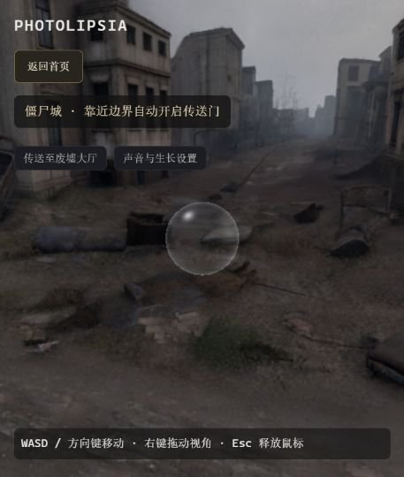 The glass ball in the zombie city, after the portal</td>
</tr>
</table>

Steering the ball took the performer's full attention and left none for the music. This finding set the requirement for the final control scheme: movement and effects must share one controller and leave the performer free to follow the music.

### Prototype 3: the engine comparison in Unity (early Nov)

The third prototype tested whether a game engine could carry an editable ten-scene piece. It runs in **Unity (URP) with the UnityGaussianSplatting package** and covers the full show structure:

- the first scene rendered at 1,920,000 splats, with a whole-object "breathing" prototype that reacts to the music;
- a Timeline camera move, followed by free walking for direct recording;
- ten scenes with one continuous music track, scene switching and game-controller flight;
- a beat-triggered **dust particle** effect, which tested effects placed on top of the scene;
- a Hydra-style effect system in Unity shaders, with 34 hand-written functions and a small compiler.

Unity version: the entrance scene rendered with UnityGaussianSplatting

The comparison decided the platform. Hydra is built on WebGL/GLSL, and **Unity's rendering cannot connect to Hydra**, so in Unity every effect would have to be rewritten by hand, while Hydra itself, live, is part of my VJ practice. The Unity package also does not expose individual splat positions, which rules out the per-splat audio deformation from Prototype 1. The dust particle test led to the same choice from the visual side, because the effects I wanted act in the splats themselves. The final instrument therefore runs in the browser, where the splats and Hydra share one canvas.

### Prototype 4: the controller-driven VJ instrument (4–5 Nov)

The fourth prototype combines the three results into the **live VJ instrument**:

1. A **controller test page** checks that the browser reads every stick, trigger and button.
2. **Free flight** with an Xbox controller: the left stick moves, the right stick looks around, the D-pad rises and falls.
3. **Hydra (hydra-synth 1.4.0)** runs on the same canvas as the splats. LT controls feedback trails, RT controls the current preset's strength, and LB/RB switch presets.
4. **The ten scenes** replace the two test worlds. Start moves to the next scene, and the transition waits for the next strong beat (up to 1 second) and uses either a freeze-dissolve or a particle scatter.
5. A **music link** lets the show track drive splat motion and effect strength. The performer can switch to a live microphone, pick another track or scrub through it.
6. **Ten effect presets** are joined by button-triggered effects: flash, RGB split, neon edge, black-and-white, hue shift, pixelate and freeze.
7. A **dual-screen setup** puts a control console on the laptop and a clean output window on the projector.

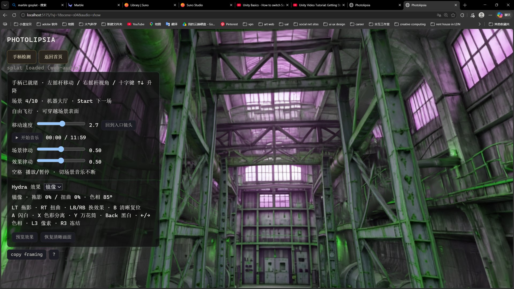
Early version of the web VJ panel (Chinese UI) in the Machine Hall

---

## 3. The End Result

The final piece is a **10-minute live VJ performance**. A single continuous music track plays while I fly through all ten scenes with one controller and play the Hydra effects on top, moving from ruin to garden.

[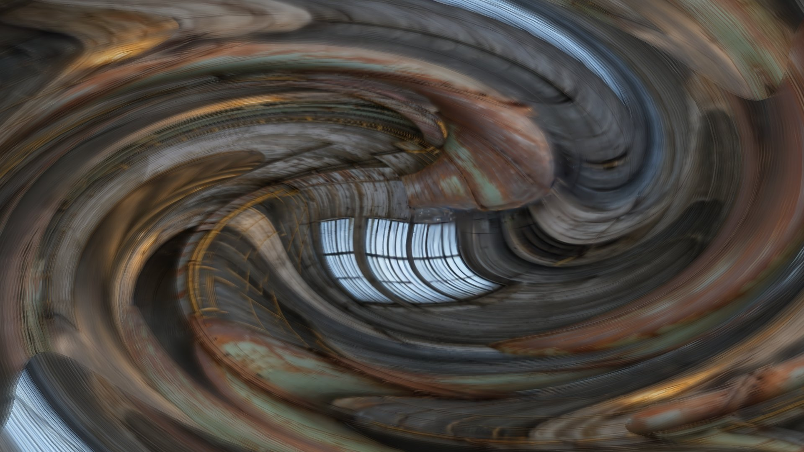](https://youtu.be/71Y-s4JzuZc)

▶ **Watch the full 10-minute performance on YouTube:** <https://youtu.be/71Y-s4JzuZc>

### Hydra effects on the splat scenes

<table>
<tr>
<td> Vortex · Machine Hall</td>
<td>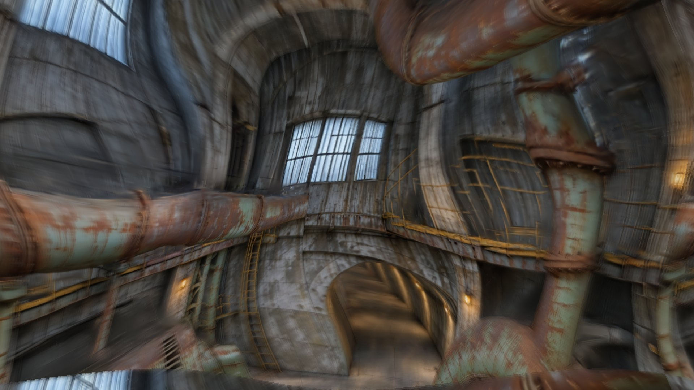 Ripple · Machine Hall</td>
</tr>
<tr>
<td>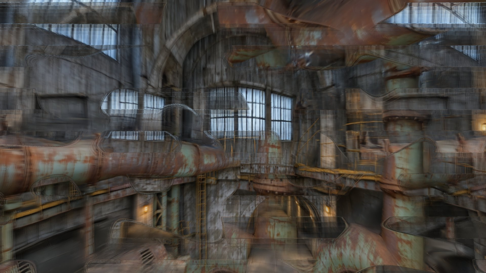 Scan glitch · Machine Hall</td>
<td>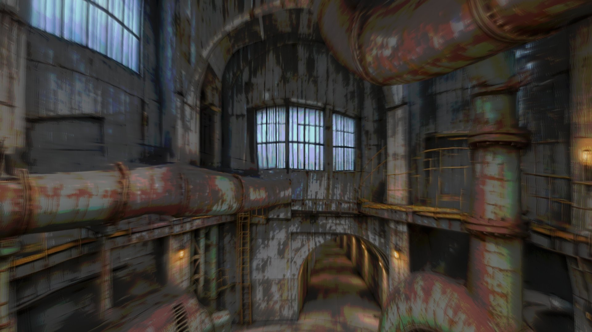 Posterize · Machine Hall</td>
</tr>
<tr>
<td>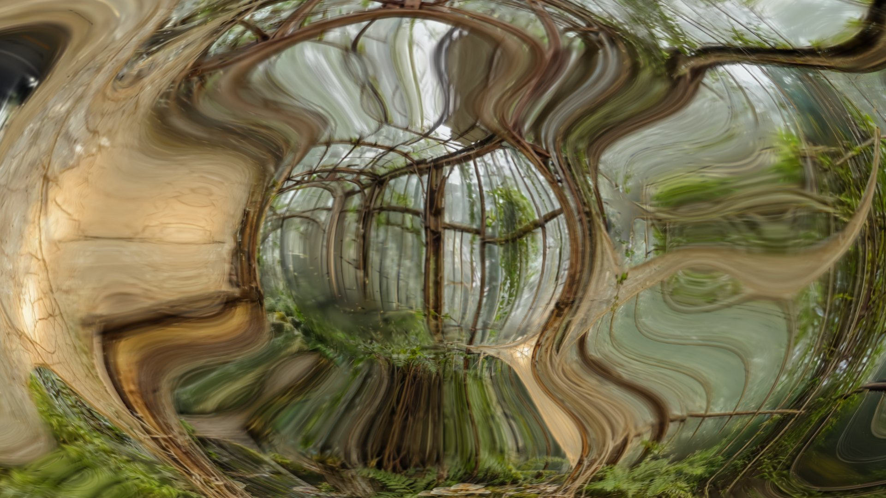 Tunnel · Mycelium Greenhouse</td>
<td>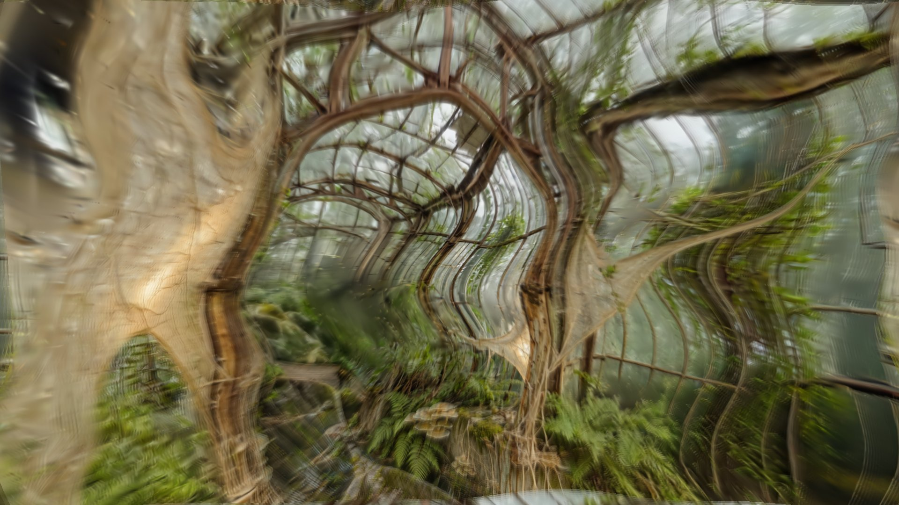 Echo · Mycelium Greenhouse</td>
</tr>
<tr>
<td> Melt · Rebirth Garden</td>
<td>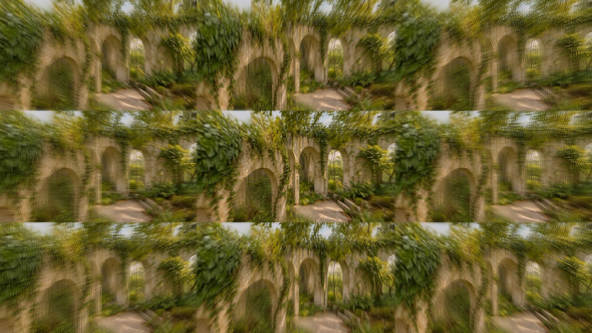 Split · Rebirth Garden</td>
</tr>
</table>

### The performance console

Laptop console with the output preview and live key map on the left and the scene, music, effect and flight panels on the right. A separate window sends the clean image to the projector.

### Controller mapping

| Input | Action |
|---|---|
| Left stick / right stick | Move / look |
| D-pad ↑ ↓ | Rise / descend |
| D-pad ← → | Hue shift |
| LT | Feedback trails |
| RT | Strength of current preset |
| LB / RB | Previous / next preset (10 total) |
| Start | Next scene (beat-synced transition) |
| A (hold) | White flash |
| X / Y / Back | RGB split / neon edge / black-and-white |
| L3 / R3 | Pixelate / freeze |
| B | Clear everything back to the clean image |

### Technical summary

- **Scenes:** ten Gaussian-splat worlds generated with Marble (World Labs), exported as PLY (~130 MB each)
- **Rendering:** three.js 0.186 + Spark 2.4 (Gaussian splats)
- **Effects:** hydra-synth 1.4.0 on the same canvas
- **Audio:** Web Audio analysis → `AVParams` protocol (also supports OSC and MIDI)
- **Input:** Gamepad API, Xbox controller
- **Output:** dual-screen console with a clean output window

---

## 4. Findings

- **The platform follows the practice.** Hydra is part of how I perform, so the instrument runs where Hydra and the splats share one canvas. The browser provides that canvas together with per-splat deformation.
- **Effects act in the material.** Sound moves and dissolves the splats themselves, and Hydra reshapes the image they form, so the scene itself reacts to the music.
- **One controller leaves room for the music.** Free flight and all effects sit on a single controller, which lets one performer play camera, image and transitions in time with the track.
- **Plan-first work with an agent.** A written plan before each step and a log after each session kept every change of direction traceable, including the reason for each decision.

### Next steps

- Per-scene camera paths and calibrated starting points
- Bringing the plant growth from Prototype 2 into the performance scenes
- Live OSC input from music software for performances with other musicians

---

## Links

- Web version (final, this repository): [README](../README.md) · <https://github.com/orangespy-arts/photolipsia>
- Unity prototype: <https://github.com/orangespy-arts/guassian-splating-unity>
- Course kit: <https://github.com/xohm/photolipsia-agentic-kit>
